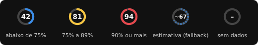

<p align="center">
  
</p>

<h1 align="center">Breath</h1>

<p align="center">
  <strong>Saiba quanto fôlego ainda resta no seu Claude, direto na barra do seu Linux.</strong><br>
  Os limites da sessão de 5h e da semana, sempre à vista, com aviso antes de acabar.
</p>

<p align="center">
  
</p>

```bash
curl -fsSL https://raw.githubusercontent.com/gaabrenno/breath/main/install.sh | bash
```

<p align="center"><sub>Linux (GNOME, KDE, XFCE, Cinnamon…) · Claude Code com assinatura Pro ou Max · sem login, sem configuração</sub></p>

<p align="center"><a href="https://gaabrenno.github.io/breath/"><strong>gaabrenno.github.io/breath</strong></a></p>

---

## Por que usar

🫁 **Veja de relance.** Dois anéis na barra mostram quanto você já usou da
sessão de 5 horas e da semana. Azul é tranquilo, amarelo pede atenção e vermelho
avisa que está acabando.

⏳ **Saiba antes de acabar.** O Breath calcula o seu ritmo e avisa se, desse
jeito, o limite vai acabar antes do reset. Por exemplo: *"Nesse ritmo, você vai
esgotar seu limite semanal sexta-feira de madrugada, antes da redefinição de
segunda-feira."*

🔑 **Sem login, sem configuração.** Ele aproveita a sessão que o Claude Code já
tem no seu computador. É instalar e pronto.

🔄 **Sempre atualizado.** Versões novas chegam sozinhas, com uma notificação
avisando.

## Onde funciona

O instalador descobre o seu ambiente e instala o que cabe nele:

| Ambiente | O que você ganha |
|---|---|
| GNOME 45 a 50 | Os anéis na barra superior (extensão do GNOME) |
| KDE Plasma, XFCE, Cinnamon, MATE, Budgie, GNOME mais antigo | Dois ícones na bandeja, um por anel |
| Hyprland, Sway, i3 e afins | O comando `breath`, para a sua barra de status |

O comando `breath` vem em todos os modos. Para escolher o modo na mão:

```bash
curl -fsSL https://raw.githubusercontent.com/gaabrenno/breath/main/install.sh | bash -s -- --tray   # ou --gnome, --cli
```

## Como funciona

Cada anel muda de cor conforme o uso:

<p align="center">
  
</p>

**Passe o mouse sobre os anéis** para ver os detalhes: quanto falta, quando cada
limite reseta e como está o seu ritmo.

<p align="center">
  
</p>

O aviso de ritmo no topo do painel segue a mesma lógica de cores:

| | Quando aparece |
|---|---|
| 🔵 | No ritmo atual, você chega ao reset **com crédito** |
| 🟡 | O limite acaba **pouco antes** do reset: até 1 dia antes na semana, ou até 45 min antes na sessão |
| 🔴 | O limite acaba **bem antes** do reset |

E quando um limite passa de **90%**, você recebe uma notificação do sistema,
uma vez por janela.

**Clicando nos anéis**, você pode atualizar na hora ou abrir a página de uso
no claude.ai.

### Na bandeja

Fora do GNOME, o Breath aparece como dois ícones na bandeja: a sessão de 5h e
a semana, cada um com a % no centro e as mesmas cores. **Clique** em um deles
para abrir o painel de detalhes, no mesmo visual da extensão (ritmo, barras,
horários de reset e os botões **Atualizar agora** e **Abrir uso no claude.ai**).
No KDE, o painel abre junto do mouse. O clique direito abre um menu com as
mesmas ações. O painel usa o GTK4, que quase toda distro já traz.

### Comando `breath`

```
$ breath
Limites do Claude · Plano Max
Sessão (janela de 5h)        42%  Reseta às 15:00 · em 2h 28min
Semanal (todos os modelos)   67%  Reseta seg 30 nov, 09:00 · em 3d 15h
Fonte: API /usage · atualizado há 1min

$ breath --short      # 5h 42% · sem 67%
$ breath --waybar     # JSON para a waybar
$ breath --json       # a leitura completa, para scripts
$ breath refresh      # consulta agora
```

O comando reaproveita a última leitura por até 150 segundos, então a sua barra
pode chamá-lo com frequência sem sobrecarregar nada.

**waybar** (`config.jsonc`):

```jsonc
"custom/breath": {
    "exec": "breath --waybar",
    "return-type": "json",
    "interval": 30
}
```

A `class` vem como `ok`, `warn` (75% ou mais), `crit` (90% ou mais) ou `stale`
(estimativa ou sem dados), para você colorir no `style.css`.

**polybar**:

```ini
[module/breath]
type = custom/script
exec = breath --short
interval = 30
```

**i3blocks**:

```ini
[breath]
command=breath --short
interval=30
```

## Perguntas frequentes

<details>
<summary><strong>Preciso fazer login no Breath?</strong></summary>

Não. O Breath não tem login. Ele **lê, só para leitura, o token da sessão do
Claude Code** que já está no seu computador (`~/.claude/.credentials.json`) e
usa esse token para consultar o seu uso, do mesmo jeito que o comando `/usage`
do Claude Code faz.

Ele nunca pede senha, nunca renova o token e nunca altera esse arquivo, então
não atrapalha o seu login no Claude Code. Se você trocar de conta no Claude
Code, o Breath acompanha sozinho.
</details>

<details>
<summary><strong>Os números batem com o claude.ai?</strong></summary>

Sim. Eles vêm da mesma fonte e somam todo o seu uso: web, app e Claude Code.
</details>

<details>
<summary><strong>Uso o Claude só pelo site. Funciona?</strong></summary>

Infelizmente, não. O Breath precisa do **Claude Code instalado e logado** com
uma assinatura **Pro ou Max**, porque é dessa sessão que ele tira o acesso. Mas
você não precisa usar o Claude Code no dia a dia: basta ele estar logado.

Contas que usam chave de API do Console não têm limites de sessão e de semana,
então não há o que mostrar.
</details>

<details>
<summary><strong>O que aparece se eu ficar dias sem abrir o Claude Code?</strong></summary>

O Claude Code só renova o acesso enquanto está aberto. Sem ele, o Breath mostra
o **último valor oficial com a idade dele** (por exemplo, "Oficial há 3h"), com
o anel tracejado. Se houver uso no Claude Code depois disso, ele soma uma
**estimativa** (`~`) feita a partir dos registros locais. Quando você abre o
Claude Code de novo, os números oficiais voltam.
</details>

<details>
<summary><strong>Meus dados saem do meu computador?</strong></summary>

Só a consulta de uso, que vai direto para `api.anthropic.com`. O Breath nunca
registra o token em logs e não segue redirecionamentos, então o token não tem
como ir parar em outro lugar. Tudo o que ele guarda fica em
`~/.cache/breath/state.json`.

> O endpoint de uso não é documentado pela Anthropic e pode mudar sem aviso.
> Se isso acontecer, o Breath passa para o modo de estimativa até ganhar uma
> versão corrigida.
</details>

<details>
<summary><strong>Funciona na minha distro?</strong></summary>

Funciona em qualquer Linux com sessão gráfica (veja [Onde funciona](#onde-funciona)).
No GNOME 45 a 50 ele vira uma extensão; nos outros ambientes, ícones na bandeja.

Fora do GNOME, o Breath precisa do `gjs`. Se faltar, o instalador avisa e
mostra o comando:

| Distro | Comando |
|---|---|
| Ubuntu, Debian | `sudo apt install gjs gir1.2-soup-3.0 gir1.2-gdkpixbuf-2.0` |
| Fedora | `sudo dnf install gjs` |
| Arch | `sudo pacman -S gjs libsoup3` |
| openSUSE | `sudo zypper install gjs` |

Em GNOME anterior ao 45, os ícones da bandeja precisam da extensão
"AppIndicator and KStatusNotifierItem Support" (o Ubuntu já traz). Lá, o clique
também abre o painel, mas ele aparece onde o GNOME decidir, e o primeiro clique
depois de abrir só fecha um menu invisível da AppIndicator. A bandeja
antiga do X11 (a do i3bar, por exemplo) não é suportada: nesse caso, use o
comando `breath`.

Sem systemd, a própria bandeja procura as atualizações. No modo só com o
comando, as atualizações automáticas ficam desligadas.
</details>

<details>
<summary><strong>Como funcionam as atualizações?</strong></summary>

A cada hora, e 2 minutos depois do login, o Breath procura uma versão nova. Se
houver, ele baixa e avisa: *"Breath atualizado para vX.Y.Z"*. Na bandeja e no
comando, a versão nova já vale na hora; na extensão do GNOME, ela vale depois de
sair e entrar de novo na sessão. Sem internet, ele só tenta de novo mais tarde.

```bash
systemctl --user start breath-update.service          # procurar agora
systemctl --user disable --now breath-update.timer    # desligar as atualizações
```

Como as versões novas rodam no seu computador, só instale se confiar neste
repositório. As versões publicadas são protegidas: depois de lançada, uma
versão nunca é alterada.
</details>

<details>
<summary><strong>Como desinstalo?</strong></summary>

```bash
curl -fsSL https://raw.githubusercontent.com/gaabrenno/breath/main/uninstall.sh | bash
```

O desinstalador remove a extensão, as atualizações automáticas e os arquivos do
Breath. Ele não toca no seu login do Claude Code.
</details>

## Instalação

```bash
curl -fsSL https://raw.githubusercontent.com/gaabrenno/breath/main/install.sh | bash
```

Antes de mexer em qualquer coisa, o instalador confere se você tem `git`, o
Claude Code logado e, fora do GNOME, o `gjs`, e explica o que falta, se for o
caso. Na bandeja, os ícones aparecem na hora. No GNOME, **encerre a sessão e
entre de novo** para os anéis aparecerem na barra.

---

<details>
<summary><strong>Para desenvolvedores</strong></summary>

### Rodando localmente

```bash
git clone git@github.com:gaabrenno/breath.git && cd breath
TZ=America/Sao_Paulo gjs -m tests/run.js   # testes da lógica (extension/lib)
bash tests/shell/run.sh                    # testes do instalador e do atualizador
gjs -m scripts/smoke-api.js                # chamada real à API; imprime só as porcentagens
```

`scripts/dev-link.sh` faz a extensão usar a sua pasta de desenvolvimento, e
`scripts/dev-link.sh --off` volta para a instalação normal. Para ver o
resultado sem sair da sessão, abra um GNOME dentro de uma janela (requer o
pacote `mutter-dev-bin`):

```bash
dbus-run-session gnome-shell --devkit --wayland
```

Para a bandeja e o comando, rode direto da pasta (a bandeja nova substitui a
que estiver aberta; os avisos saem no terminal):

```bash
gjs -m linux/tray.js
bin/breath --waybar
```

Os logs da extensão:

```bash
journalctl -f -o cat /usr/bin/gnome-shell | grep breath
```

### Publicando uma versão

A partir da `main`, com a árvore limpa:

```bash
scripts/release.sh 1.1.0
```

O script roda os testes, grava a versão no `metadata.json`, cria a tag `v1.1.0`
e envia. As instalações recebem a versão em até 1 hora. Versões publicadas não
podem ser alteradas nem apagadas, então, para corrigir um problema, publique
uma versão nova.

### Estrutura

| Caminho | O que contém |
|---|---|
| `extension/lib/` | Lógica: credenciais, API, contagem de tokens nos logs, estimativa, aviso de ritmo, notificações e ciclo de atualização |
| `extension/ui/` | O anel (Cairo) e o painel do hover |
| `extension/extension.js` | Liga tudo na barra do GNOME |
| `linux/` | Bandeja (StatusNotifierItem e dbusmenu), comando `breath`, textos e cache da leitura |
| `bin/breath` | O comando `breath` |
| `install.sh`, `uninstall.sh` | Instalador e desinstalador de um comando |
| `scripts/` | Atualizador, publicação de versões, `dev-link` e teste da API |
| `systemd/` | Timer de atualização automática |
| `tests/` | Testes em GJS e em shell, sem dependências externas |
| `docs/` | Design, planos de implementação e imagens |

</details>

<p align="center"><sub>Projeto independente, sem vínculo com a Anthropic. Claude é uma marca da Anthropic.</sub></p>
