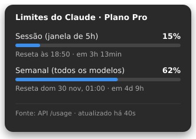

# Breath

Extensão do GNOME Shell que mostra os **limites de uso do Claude** na barra
superior: dois anéis, um para a **sessão de 5 horas** e outro para o **limite
semanal**. Passe o mouse para ver quando cada um reseta.

> Projeto não oficial, sem vínculo com a Anthropic.


## Como funciona

**Na barra**, cada anel mostra a porcentagem usada e muda de cor conforme o consumo:


- **Azul**: abaixo de 75%
- **Amarelo**: de 75% a 89%
- **Vermelho**: 90% ou mais (você recebe **uma notificação** por janela)
- **Tracejado com `~`**: estimativa, usada quando não há dado oficial recente
- **Cinza com `–`**: ainda sem nenhum dado

**Ao passar o mouse**, abre um painel com a porcentagem, a barra de progresso e
o horário de reset de cada limite, além da origem do dado e de quando ele foi
atualizado:



### Aviso de ritmo

No topo do painel, o Breath projeta como cada limite vai estar no reset se você
mantiver o ritmo médio desde o início da janela:

| Cor | Quando aparece |
|---|---|
| 🔵 Azul | você chega ao reset **com crédito** (mesmo que com 99%) |
| 🟡 Amarelo | o limite acaba **pouco antes** do reset: até **1 dia** antes na semana, ou até **45 min** antes na sessão de 5h |
| 🔴 Vermelho | o limite acaba com mais antecedência que isso |

A caixa grande mostra o limite mais grave. Se empatar, mostra o que acaba
primeiro. Logo abaixo, uma linha curta mostra o outro limite, com uma bolinha na
cor dele. Logo depois de um reset, o aviso só aparece depois de 20 min de sessão
ou 6 h de semana, porque antes disso a média ainda não é confiável.

**Ao clicar**, abre um menu com **Atualizar agora** e **Abrir uso no claude.ai**.

Os dados são atualizados a cada 2 minutos. Se a API pedir para esperar, o
intervalo dobra até no máximo 10 minutos.

## Conexão com o Claude: sem login

O Breath **não pede login e não se conecta à sua conta por conta própria**. Ele
aproveita a sessão que o **Claude Code** já mantém no seu computador:

1. Quando você faz login no Claude Code (`claude` e depois `/login`), ele guarda o
   token da sua conta em `~/.claude/.credentials.json`.
2. A cada 2 minutos, o Breath **lê esse token, só para leitura**, e com ele
   consulta o uso da conta no mesmo endpoint que o comando `/usage` do Claude
   Code usa.
3. Se você trocar de conta no Claude Code, o Breath passa a mostrar a conta nova
   no ciclo seguinte.

O Breath **nunca** pede senha, abre tela de login, renova o token ou altera o
arquivo de credenciais. Por isso ele não interfere no login do Claude Code.

**O que isso significa para você:**

- É preciso ter o **Claude Code instalado e logado com uma assinatura (Pro ou
  Max)**, mesmo que você use o Claude mais pela web ou pelo app. Os números
  mostrados somam tudo: web, app e Claude Code.
- Quem usa **só o claude.ai**, sem o Claude Code, não consegue usar o Breath: o
  painel fica em "Sem dados ainda".
- Contas que usam **chave de API do Console** não têm limites de sessão e de semana
  para mostrar.
- **Token expirado:** o Claude Code só renova o token enquanto está aberto. Se você
  ficar um tempo sem abri-lo, o Breath mostra o **último valor oficial com a idade
  dele** (por exemplo, "Oficial há 3h"). Se houver uso no Claude Code depois
  disso, ele soma um **acréscimo estimado** (`~`) a partir dos logs locais em
  `~/.claude/projects/*/*.jsonl`. Ao abrir o Claude Code de novo, os números
  oficiais voltam.

O endpoint de uso não é documentado pela Anthropic e pode mudar sem aviso. Se o
formato da resposta mudar, o Breath passa automaticamente para o modo de
estimativa.

### Segurança e privacidade

- O token é **somente lido** e nunca aparece em logs.
- As requisições **não seguem redirecionamentos**: o token só vai para
  `api.anthropic.com`.
- Nada sai do seu computador além dessa consulta. O estado (último valor
  oficial, calibração e notificações já enviadas) fica em
  `~/.cache/breath/state.json`.

## Requisitos

- GNOME Shell 49 (testado no Ubuntu 25.10, Wayland)
- `git`
- Claude Code instalado e logado com uma assinatura Pro ou Max

## Instalação

Um comando só:

```bash
curl -fsSL https://raw.githubusercontent.com/gaabrenno/breath/main/install.sh | bash
```

O instalador confere os requisitos antes de mexer em qualquer coisa e explica o
que falta, se for o caso. Depois ele:

1. baixa a última versão publicada em `~/.local/share/breath`;
2. ativa a extensão;
3. liga a atualização automática.

No Wayland, **encerre a sessão e entre de novo** para o Breath aparecer na barra.

### Atualizações automáticas

A cada hora (e 2 minutos depois do login), o Breath procura uma versão nova
publicada. Se houver, ele baixa e mostra a notificação *"Breath atualizado para
vX.Y.Z — vale na próxima sessão"*. Sem internet, ele só tenta de novo mais tarde.

```bash
systemctl --user list-timers breath-update.timer      # próxima checagem
systemctl --user start breath-update.service          # checar agora
systemctl --user disable --now breath-update.timer    # desligar as atualizações
```

> Atualizações automáticas significam que o código publicado neste repositório
> passa a rodar no seu GNOME. Instale apenas se confiar nele.

### Desinstalar

```bash
curl -fsSL https://raw.githubusercontent.com/gaabrenno/breath/main/uninstall.sh | bash
```

O desinstalador remove a extensão, a atualização automática,
`~/.local/share/breath` e `~/.cache/breath`. Ele não toca nas credenciais do
Claude Code.

## Desenvolvimento

```bash
git clone git@github.com:gaabrenno/breath.git && cd breath
TZ=America/Sao_Paulo gjs -m tests/run.js   # testes da lógica (extension/lib)
bash tests/shell/run.sh                    # testes do instalador e do atualizador
gjs -m scripts/smoke-api.js                # chamada real à API; imprime só as porcentagens
```

**Testar código não publicado:** `scripts/dev-link.sh` faz a extensão apontar para
a sua pasta de desenvolvimento. `scripts/dev-link.sh --off` volta para a
instalação normal. Para ver o resultado sem sair da sessão, abra um GNOME dentro
de uma janela (requer o pacote `mutter-dev-bin`):

```bash
dbus-run-session gnome-shell --devkit --wayland
```

**Publicar uma versão:** a partir da `main`, com a árvore limpa:

```bash
scripts/release.sh 1.1.0
```

O script roda os testes, grava a versão no `metadata.json`, cria a tag `v1.1.0`
e envia. Todas as instalações recebem a versão em até 1 hora. Para corrigir uma
versão com problema, publique uma nova.

Estrutura:

| Caminho | O que contém |
|---|---|
| `extension/lib/` | Lógica pura: credenciais, leitura da API, contagem de tokens nos logs, estimativa do fallback, aviso de ritmo, regra de notificação e ciclo de atualização |
| `extension/ui/` | O anel (Cairo) e o painel do hover |
| `extension/extension.js` | Liga tudo na barra do GNOME |
| `install.sh`, `uninstall.sh` | Instalador e desinstalador de um comando |
| `scripts/` | Atualizador, publicação de versões, `dev-link` e teste da API |
| `systemd/` | Timer de atualização automática |
| `tests/` | Testes em GJS e em shell, sem dependências externas |
| `docs/superpowers/` | Design e planos de implementação |
| `docs/images/` | Mockups usados neste README |

Os logs da extensão podem ser acompanhados com:

```bash
journalctl -f -o cat /usr/bin/gnome-shell | grep breath
```
